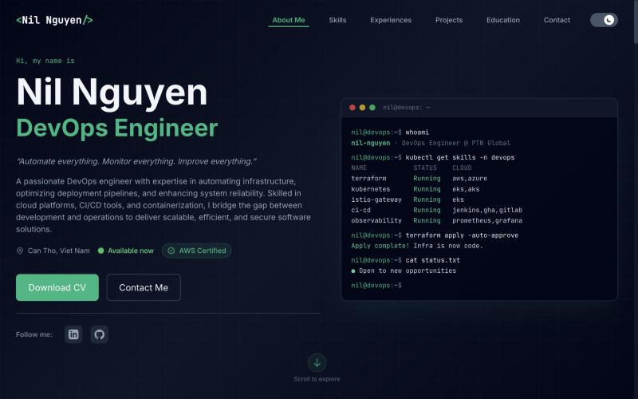

# NProfile

Personal portfolio of **Nil Nguyen**, DevOps Engineer. Built with React, Vite, Tailwind CSS and Framer Motion, and deployed to GitHub Pages.

**Live site:** https://nilnguyen2k.github.io/NProfile/



## Features

- 💻 **Terminal-style hero**: an animated terminal that types DevOps commands (`kubectl`, `terraform`...) and prints their output
- 📊 **Quick facts strip**: years of experience is calculated from the career start date, and the tool count comes from the skills list
- 🧰 **Skills, experience, projects, education and certifications**, all driven by plain data in the code
- 🌙 **Dark/light mode**, remembered between visits
- 📱 **Responsive** layout, tested at mobile (375px) and desktop (1280px) widths
- ♿ **Accessibility basics**: skip link, keyboard focus styles and `prefers-reduced-motion` support
- 🎯 **Scrollspy navigation** that highlights the active section
- ✉️ **Contact form** powered by EmailJS
- 🔗 **Social previews**: Open Graph and Twitter tags plus a preview image, so shared links render as cards

## Tech Stack

| Area       | Tool                 |
| ---------- | -------------------- |
| Framework  | React 18.3           |
| Build tool | Vite 6               |
| Styling    | Tailwind CSS 3.4     |
| Animation  | Framer Motion 11     |
| Email      | EmailJS 4.4          |
| Hosting    | GitHub Pages (`gh-pages`) |

## Getting Started

**Requirements:** Node.js 18 or newer.

```bash
git clone https://github.com/nilnguyen2k/NProfile.git
cd NProfile
npm install
npm run dev
```

The dev server runs at http://localhost:3000/NProfile/ (note the `/NProfile/` base path).

### Environment variables

The contact form needs EmailJS credentials. Copy `.env.example` to `.env` and fill it in:

```env
VITE_EMAILJS_PUBLIC_KEY=your_emailjs_public_key
VITE_EMAILJS_SERVICE_ID=your_emailjs_service_id
VITE_EMAILJS_TEMPLATE_ID=your_emailjs_template_id
```

To get them:

1. Sign up at [EmailJS](https://www.emailjs.com/).
2. Create an email service.
3. Create a template that uses `{{user_name}}`, `{{user_email}}` and `{{message}}`.

Without these values the site still works. The form then shows a message asking visitors to email directly.

## Scripts

| Command           | What it does                                      |
| ----------------- | ------------------------------------------------- |
| `npm run dev`     | Start the dev server                              |
| `npm run lint`    | Run ESLint                                        |
| `npm run build`   | Build the production site into `dist/`            |
| `npm run preview` | Serve the production build locally                |
| `npm run deploy`  | Build and publish `dist/` to the `gh-pages` branch |

## Project Structure

```
NProfile/
├── public/
│   ├── terminal.svg          # Favicon
│   └── og-image.jpg          # Social preview image
├── screenshots/              # Images used in this README
├── src/
│   ├── assets/               # CV (PDF) and project images
│   ├── components/
│   │   ├── layout/           # Header, Footer
│   │   ├── sections/         # Hero, Stats, Skills, Experience, Projects, Education, Contact
│   │   └── ui/               # Button, Terminal, SectionHeading, ThemeToggle
│   ├── contexts/             # Theme context
│   ├── hooks/                # Scroll, active section, reduced motion
│   ├── lib/                  # constants.js (site data) and utils
│   └── styles/               # Global styles
├── index.html                # Meta tags, Open Graph, structured data
├── tailwind.config.js
└── vite.config.js            # base: '/NProfile/'
```

## Updating Content

Most content is plain data, so updating it means editing an array.

| What                         | Where                                                        |
| ---------------------------- | ------------------------------------------------------------ |
| Navigation, social links     | `src/lib/constants.js` → `NAV_SECTIONS`, `SOCIAL_LINKS`      |
| Skills                       | `src/lib/constants.js` → `SKILL_CATEGORIES`                  |
| Certifications               | `src/lib/constants.js` → `CERTIFICATIONS`                    |
| Career start (years counter) | `src/lib/constants.js` → `CAREER_START`                      |
| Contact email                | `src/lib/constants.js` → `CONTACT_EMAIL`                     |
| CV file                      | Put the PDF in `src/assets/cv/` and update the import in `constants.js` |
| Terminal commands            | `src/components/ui/Terminal.jsx` → `SESSION`                 |
| Work experience              | `src/components/sections/Experience.jsx` → `EXPERIENCE`      |
| Projects                     | `src/components/sections/Projects.jsx` → `PROJECTS`          |
| Education                    | `src/components/sections/Education.jsx` → `EDUCATION`        |
| Page title, SEO, previews    | `index.html`                                                 |

## Deployment

The site is hosted on GitHub Pages from the `gh-pages` branch:

```bash
npm run deploy
```

This builds the site and pushes `dist/` to `gh-pages`. Merging into `main` alone does **not** update the live site, so run the deploy after merging.

If you fork this repo under another name, change `base` in `vite.config.js` and the URLs in `index.html` to match.

## License

[MIT](LICENSE) © Nil Nguyen

## Contact

- LinkedIn: [linkedin.com/in/nilnguyen](https://www.linkedin.com/in/nilnguyen/)
- GitHub: [@nilnguyen2k](https://github.com/nilnguyen2k)
